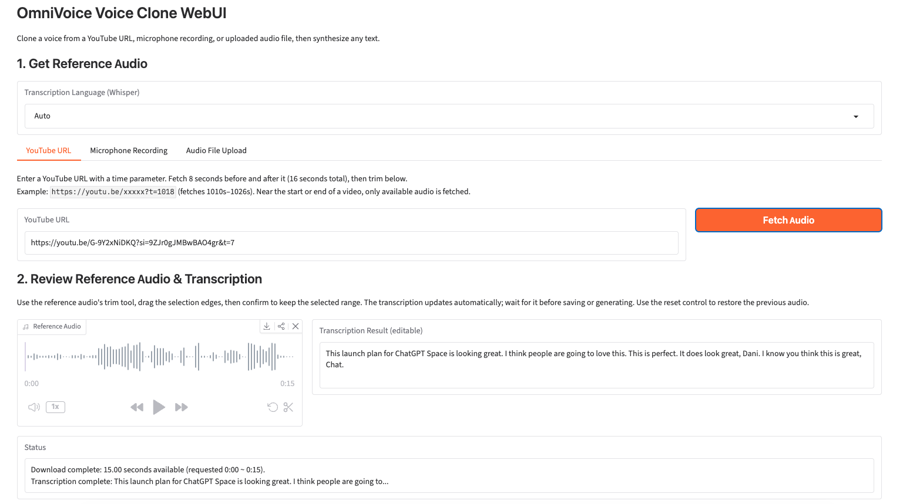
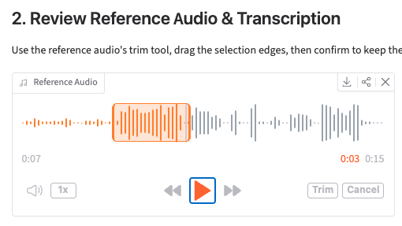
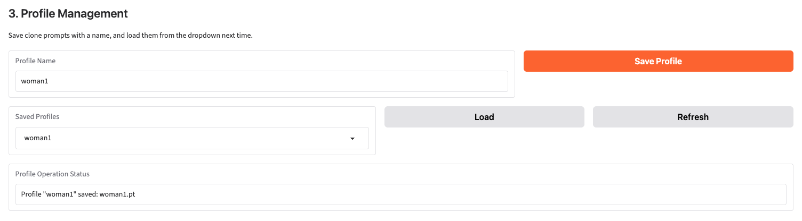
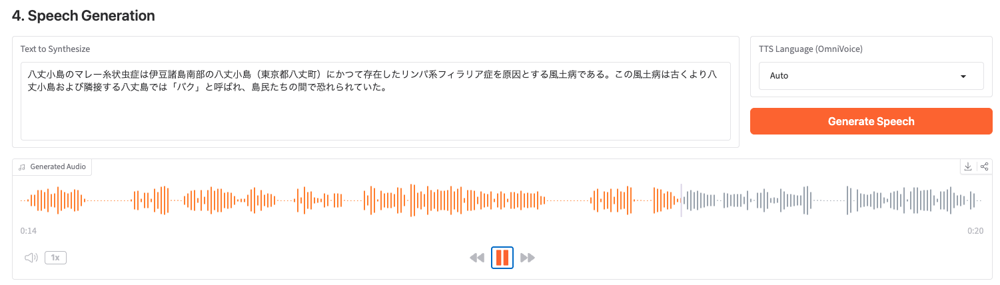

<table>
  <thead>
    <tr>
      <th style="text-align:center"><a href="README-Japanse.md">日本語</a></th>
      <th style="text-align:center"><a href="README.md">English</a></th>
    </tr>
  </thead>
</table>

# OmniVoice Voice Clone WebUI

短い音声サンプルをもとに、入力したテキストをその声で読み上げます。このGradioアプリはApple Silicon搭載Macで動作し、音声のクローンに**OmniVoice**、参照音声の文字起こしに**Whisper large-v3-turbo**を使用します。モデルのファインチューニングは不要です。

参照音声には、YouTubeのタイムスタンプ、マイク録音、または音声ファイルを使用できます。ブラウザー上で音声をトリミングし、文字起こしを確認してから、OmniVoiceの言語リストにある日本語などの言語で音声を生成できます。ボイスプロフィールを保存すれば、同じ参照音声を後から再利用できます。

[](githubreadme/reference-audio.png)

*WebUIでの参照音声と文字起こし。スクリーンショットをクリックすると拡大表示できます。*

## 必要な環境

- **macOS 26.x以降を搭載したApple Silicon Mac。** 検証に使用した環境は、ユニファイドメモリ24 GBのMac mini M4です。これは必要な最小メモリ容量を示すものではありません。
- **Python 3.13**（`>=3.13,<3.14`）。`.python-version`でバージョンを指定しています。
- セットアップと音声処理に**Git**、**[Homebrew](https://brew.sh/)**、**[uv](https://docs.astral.sh/uv/getting-started/installation/)**、**FFmpeg**が必要です。
- 初回のモデルダウンロードとYouTube音声の取得にはインターネット接続が必要です。

既定のTTS設定では、MPS、float16の重み、SDPA attentionを使用します。ほかのOSやハードウェアでは動作を検証していません。

## インストールと起動

ターミナルで次のコマンドを実行します。

```bash
brew install uv ffmpeg

git clone https://github.com/Shuichi346/omnivoice-voice-clone-webui.git
cd omnivoice-voice-clone-webui

uv sync --locked
uv run --locked voice-clone-webui
```

ブラウザーで**[http://127.0.0.1:7860](http://127.0.0.1:7860)**を開きます。サーバーを停止するには、ターミナルで`Ctrl+C`を押します。再度起動するときは、リポジトリのディレクトリで`uv run --locked voice-clone-webui`を実行してください。

`uv sync --locked`は、コミット済みの依存関係ロックファイルを使ってプロジェクト内に`.venv`を作成します。別途、仮想環境を有効化する必要はありません。uvによるプロジェクト環境とPythonの管理方法については、[uvのプロジェクトガイド](https://docs.astral.sh/uv/guides/projects/)を参照してください。

モデルは初回使用時に読み込まれます。参照音声の文字起こし時にWhisper、プロフィールの保存または音声生成時にOmniVoiceが読み込まれます。重みがない場合は自動でダウンロードされるため、これらの操作には初回だけ時間がかかります。

## WebUIの使い方

### 1. 参照音声を用意する

参照音声を処理する前に、**Transcription Language (Whisper)**を選びます。**Auto**のままにするか、サンプルで話されている言語を選択してください。

| ソースタブ | 操作 |
| --- | --- |
| **YouTube URL** | `t`タイムスタンプを含むYouTube URLを貼り付け、**Fetch Audio**をクリックします。 |
| **Microphone Recording** | マイクの使用を許可して短く録音し、録音を停止します。文字起こしは自動で始まります。 |
| **Audio File Upload** | ファイルをアップロードして、**Process File**をクリックします。 |

アップロードできる形式はWAV、MP3、FLAC、OGG、OPUS、M4A、AAC、WMA、WebMです。アップロードしたファイルは、処理用に16 kHzのモノラルWAVへ変換されます。まずは話者が1人で、音声が明瞭な3〜10秒程度のサンプルを用意し、無音や関係のない発話をトリミングしてください。

YouTubeでは、タイムスタンプが取得するクリップの**中央**になります。たとえば、URL末尾が`?t=1018`の場合、16:58の前後8秒にあたる**16:50〜17:06**を取得します。`?t=16m58s`という形式も使えます。

動画の冒頭や末尾では、利用可能な音声だけを使用します。タイムスタンプのないURLでは、最初の8秒を取得します。**Status**欄に実際にダウンロードされた時間が表示されます。

### 2. 音声をトリミングして文字起こしを確認する

**Review Reference Audio & Transcription**で次の操作を行います。

1. **Reference Audio**を再生して、サンプルを確認します。
2. はさみのツールを開き、選択範囲の端をドラッグしてから**Trim**をクリックし、選択した範囲を残します。
3. 選択した音声の文字起こしが再び行われるまで待ちます。
4. **Transcription Result (editable)**を、実際に話されている内容に合わせて修正します。音声のクローンには、空でない参照テキストが必要です。

波形のリセット操作を使うと、トリミング前の音声選択に戻せます。参照音声を変更したり、その文字起こしを編集したりすると、キャッシュ済みのクローンプロンプトは無効になります。その後に保存または生成を行うと、現在の参照音声が使われます。

[](githubreadme/trim-reference.png)

*声の参照に使いたい発話だけを選択します。*

### 3. ボイスプロフィールを保存する（任意）

**Profile Name**を入力して、**Save Profile**をクリックします。参照音声、文字起こし、再利用可能なOmniVoiceプロンプトが`voice_profiles/`に保存されます。

次回は、**Saved Profiles**からプロフィールを選択し、**Load**をクリックして読み込みます。**Refresh**をクリックすると、保存済みプロフィールの一覧が更新されます。無効な文字が置き換えられた後のファイル名が同じ場合、保存するとそのプロフィールが上書きされます。

プロフィールを保存せずに、現在の参照音声から直接音声を生成することもできます。

[](githubreadme/voice-profiles.png)

*プロフィールを保存すると、参照音声を再取得または再録音せずに再利用できます。*

### 4. 音声を生成する

**Text to Synthesize**にテキストを入力し、**TTS Language (OmniVoice)**を選んで、**Generate Speech**をクリックします。生成結果は**Generated Audio**で再生するか、ダウンロード操作で保存できます。

2つの言語設定は用途が異なります。**Transcription Language**は参照音声の言語、**TTS Language**は生成する音声の言語を指定します。TTSで**Auto**を選ぶと、言語を指定せずOmniVoiceに任せます。対応言語のドロップダウンから日本語を選べます。

[](githubreadme/speech-generation.png)

*音声生成セクションでの日本語テキストと生成音声。*

## 設定と保存ファイル

設定を変更するには[src/voice_clone_webui/config.py](src/voice_clone_webui/config.py)を編集し、サーバーを再起動します。アプリは`.env`ファイルから設定を読み込みません。

| 設定 | 既定値 | 用途 |
| --- | --- | --- |
| `OMNIVOICE_MODEL_ID` | `"k2-fsa/OmniVoice"` | Hugging FaceのモデルID、または音声トークナイザーを含む完全なローカルモデルディレクトリ。 |
| `WHISPER_MODEL_NAME` | `"large-v3-turbo"` | 文字起こしにpywhispercppが使用するモデル。 |
| `GENERATION_STEPS` | `32` | OmniVoiceの生成ステップ数。 |
| `GENERATION_SPEED` | `1.0` | 音声生成の速度パラメーター。 |
| `CLIP_CONTEXT_SEC` | `8` | YouTubeのタイムスタンプの前後それぞれに指定する秒数。 |
| `SERVER_NAME` / `SERVER_PORT` | `"127.0.0.1"` / `7860` | ローカルサーバーのアドレスとポート。 |

検証済みのApple Silicon環境では、既定のMPS、float16、SDPA設定を維持してください。MPSでは、非同期のTransformers重み読み込みを無効にし、未対応の処理を避けるためOmniVoiceの音声トークナイザーをCPU上で動かします。

| 場所 | 内容 |
| --- | --- |
| `voice_profiles/*.pt` | 参照音声と文字起こしを含む保存済みプロフィール。Gitの対象外です。 |
| `tmp/session_<uuid>/` | ブラウザーセッションとリクエストごとに分けて保存される一時参照ファイル。Gitの対象外です。 |
| `githubreadme/` | 英語版と日本語版のREADMEで使用するスクリーンショット。 |

ブラウザーセッションが終了し、期限が過ぎると、Gradioがセッションの参照ファイルを削除します。強制終了すると一時ディレクトリが残ることがあります。残ったファイルを手動で削除する場合は、先にアプリを停止してください。モデルの重みは各モデルライブラリのキャッシュに保存され、リポジトリには含まれません。

現在のプロフィールはformat 2で保存され、`omnivoice`エンジン識別子と制限付きのテンソル・コンテナ読み込みを使用します。古いformat-1プロフィールでは保存済みの音声と文字起こしを再利用できますが、以前のプロンプトはOmniVoice用に再構築されます。新しいプロンプトをキャッシュするには、プロフィールを保存し直してください。サポートされていない旧形式のpickleプロフィールは、元の録音から作り直してください。

## トラブルシューティング

| 症状 | 確認すること |
| --- | --- |
| `ffmpeg`が見つからない、または音声変換に失敗する | `ffmpeg -version`を実行します。見つからない場合は`brew install ffmpeg`でインストールしてください。元の音声ファイルを読み取れることも確認します。 |
| 初回の文字起こし、保存、生成に時間がかかる | ターミナルでモデルのダウンロードや読み込みの進行状況を確認し、インターネット接続を確認します。モデルは必要になった時点で読み込まれます。 |
| 保存または生成時に参照音声がないと表示される | 先に音声を取得、録音、アップロードするか、プロフィールを読み込みます。文字起こしの完了を待ち、テキストが空でないことを確認します。 |
| トリミングしたクリップの文字起こしが合わない | 再文字起こしが終わるまで待ち、保存または生成する前に、選択した音声に合うようテキストを編集します。 |
| YouTubeからダウンロードできない | **Status**とターミナルのエラーを確認し、URL、タイムスタンプ、動画にアクセスできるかを調べます。ローカルの音声ファイルも使用できます。 |
| ポート7860がすでに使用されている | 別のサーバーを停止するか、`config.py`の`SERVER_PORT`を変更して再起動します。 |
| 古いプロフィールを読み込めない | サポートされていないpickle形式の場合は、元の音声から作り直します。 |

## 開発

```bash
uv run --locked ruff check src tests
uv run --locked python -m unittest discover -s tests -v
```

回帰テストはFFmpegを必要とし、モデルの重みをダウンロードせずに音声変換、参照音声の処理、プロフィール保存、UIイベントの接続を検証します。文字起こしの精度や生成音声の品質を保証するものではありません。依存関係を更新するときは`uv sync`を意図的に実行し、変更された`uv.lock`も含めてください。

## コンポーネントとライセンス

- [OmniVoice](https://github.com/k2-fsa/OmniVoice) · [モデルの重み](https://huggingface.co/k2-fsa/OmniVoice)
- [pywhispercpp](https://github.com/absadiki/pywhispercpp) · [whisper.cpp](https://github.com/ggml-org/whisper.cpp)
- [Gradio](https://www.gradio.app/) · [yt-dlp](https://github.com/yt-dlp/yt-dlp) · [FFmpeg](https://ffmpeg.org/)

このリポジトリは[MIT License](LICENSE)で公開されています。モデルの重みと依存関係には、それぞれ独自のライセンスがあります。参照音声は話者の許可を得て使用し、音声の取得元サービスの利用条件を守ってください。
